# FincaNova · Diagrama entidad-relación (FincaUSER)

Generado a partir del esquema real de la base después de la migración
`RevisionEsquemaRelaciones` (28 tablas, 43 llaves foráneas, 16 restricciones CHECK).
Se ve renderizado en GitHub y en VS Code (extensión Markdown Preview Mermaid).

Por claridad se omiten en cada tabla las columnas de control comunes
`FechaCreacion`, `CreadoPor`, `FechaModificacion` y `ModificadoPor`.

## Diagrama

```mermaid
erDiagram
    %% ---------- Base ----------
    Empresas ||--o{ Terrenos : "tiene"
    Empresas ||--|| ParametrosFinca : "configura"
    Terrenos ||--o{ Terrenos : "finca contiene lotes"

    %% ---------- Seguridad ----------
    Usuarios |o--o| Colaboradores : "cuenta de"

    %% ---------- Períodos ----------
    PeriodosProductivos ||--o{ PeriodosTerrenos : "incluye"
    Terrenos ||--o{ PeriodosTerrenos : "participa en"

    %% ---------- Labores ----------
    Terrenos ||--o{ Labores : "se realiza en"
    Labores ||--o{ LaboresColaboradores : "asigna"
    Colaboradores ||--o{ LaboresColaboradores : "asignado a"
    Labores ||--o{ LaboresAvances : "registra"
    Colaboradores ||--o{ LaboresAvances : "trabaja"
    Labores ||--o{ LaboresInsumos : "consume"
    Insumos ||--o{ LaboresInsumos : "usado en"

    %% ---------- Enfermedades ----------
    Terrenos ||--o{ Enfermedades : "afecta"
    Enfermedades ||--o{ TratamientosEnfermedad : "se trata con"
    Enfermedades |o--o| TratamientosEnfermedad : "tratamiento efectivo"
    TratamientosEnfermedad ||--o{ ProductosTratamiento : "aplica"
    Insumos |o--o{ ProductosTratamiento : "rebaja"

    %% ---------- Inventario ----------
    CategoriasInsumo ||--o{ Insumos : "clasifica"
    UnidadesMedida ||--o{ Insumos : "mide"
    Insumos ||--o{ MovimientosInventario : "kardex"
    Insumos ||--o{ AlertasStock : "alerta"
    ProductosTratamiento |o--o{ MovimientosInventario : "origen salida"
    LaboresInsumos |o--o{ MovimientosInventario : "origen salida"
    Gastos |o--o{ MovimientosInventario : "origen entrada"

    %% ---------- Recolección y producción ----------
    PeriodosTerrenos ||--o{ Recolecciones : "lote del período"
    Colaboradores ||--o{ Recolecciones : "recolecta"
    PeriodosTerrenos ||--o{ PesosSecado : "lote del período"
    PeriodosTerrenos ||--o{ PesosProcesado : "lote del período"

    %% ---------- Finanzas ----------
    CategoriasGasto ||--o{ Gastos : "clasifica"
    Terrenos |o--o{ Gastos : "lote asociado"
    PeriodosProductivos |o--o{ Gastos : "período"
    PeriodosProductivos |o--o{ Ventas : "período"

    %% ---------- Pagos ----------
    Colaboradores ||--o{ PagosColaborador : "recibe"
    PagosColaborador ||--o{ PagoDetalles : "detalla"
    LaboresAvances |o--o| PagoDetalles : "jornada pagada"
    Recolecciones |o--o| PagoDetalles : "cajuelas pagadas"

    Empresas {
        int Id PK
        nvarchar Nombre
        nvarchar Ubicacion
        nvarchar Propietario
        nvarchar Telefono
    }
    ParametrosFinca {
        int Id PK
        int EmpresaId FK "UNIQUE"
        decimal KgPorCajuela
        int TamanoMaximoAdjuntoMB
        nvarchar ExtensionesAdjuntoPermitidas
    }
    Terrenos {
        int Id PK
        int EmpresaId FK
        nvarchar Codigo "UNIQUE por empresa"
        nvarchar Nombre
        int Tipo "1 Finca, 2 Lote"
        int FincaPadreId FK "solo lotes"
        decimal AreaHectareas
        nvarchar VariedadCafe
        int AnioSiembra
        int Estado
        bit Eliminado "borrado lógico"
    }
    Usuarios {
        int Id PK
        nvarchar Nombre
        nvarchar Email "UNIQUE"
        nvarchar PasswordHash
        nvarchar Rol "CHECK 4 roles"
        bit Activo
        bit Bloqueado
        int IntentosFallidos
        datetime2 BloqueadoHasta
        nvarchar PasswordResetToken
    }
    Colaboradores {
        int Id PK
        nvarchar Identificacion "UNIQUE"
        nvarchar Nombre
        nvarchar Cargo
        decimal TarifaJornada
        decimal TarifaCajuela
        bit Activo
        int UsuarioId FK "UNIQUE, opcional"
    }
    PeriodosProductivos {
        int Id PK
        nvarchar Nombre
        datetime2 FechaInicio
        datetime2 FechaFin
        bit Cerrado
    }
    PeriodosTerrenos {
        int PeriodoProductivoId PK, FK
        int TerrenoId PK, FK
    }
    Labores {
        int Id PK
        int TerrenoId FK
        int Tipo
        datetime2 Fecha
        int Estado
        decimal HorasTotales
        decimal CostoTotal
    }
    LaboresColaboradores {
        int LaborId PK, FK
        int ColaboradorId PK, FK
    }
    LaboresAvances {
        int Id PK
        int LaborId FK
        int ColaboradorId FK
        datetime2 Fecha
        decimal Horas
        decimal TarifaJornada
        decimal Costo
    }
    LaboresInsumos {
        int Id PK
        int LaborId FK
        int InsumoId FK
        decimal Cantidad
    }
    Enfermedades {
        int Id PK
        int TerrenoId FK
        nvarchar Nombre
        datetime2 FechaDeteccion
        int Estado
        bit Atendida "alerta HU-10"
        int TratamientoEfectivoId FK
    }
    TratamientosEnfermedad {
        int Id PK
        int EnfermedadId FK
        nvarchar Tratamiento
        datetime2 FechaAplicacion
        int Efectividad
    }
    ProductosTratamiento {
        int Id PK
        int TratamientoEnfermedadId FK
        int InsumoId FK "opcional"
        nvarchar NombreProducto
        decimal Cantidad
    }
    CategoriasInsumo {
        int Id PK
        nvarchar Nombre "UNIQUE"
        bit RequiereVencimiento
    }
    UnidadesMedida {
        int Id PK
        nvarchar Nombre "UNIQUE"
        nvarchar Abreviatura "UNIQUE"
    }
    Insumos {
        int Id PK
        nvarchar Nombre "UNIQUE"
        int CategoriaInsumoId FK
        int UnidadMedidaId FK
        decimal StockActual "CHECK >= 0"
        decimal StockMinimo
    }
    MovimientosInventario {
        int Id PK
        int InsumoId FK
        int Tipo "Entrada, Salida, Ajuste"
        decimal Cantidad "CHECK > 0"
        decimal StockResultante
        datetime2 FechaVencimiento
        int ProductoTratamientoId FK
        int LaborInsumoId FK
        int GastoId FK
    }
    AlertasStock {
        int Id PK
        int InsumoId FK "1 activa por insumo"
        decimal StockAlMomento
        bit Activa
    }
    Recolecciones {
        int Id PK
        int ColaboradorId FK
        int TerrenoId FK
        int PeriodoProductivoId FK
        datetime2 Fecha
        decimal Cajuelas "CHECK > 0"
        decimal KgPorCajuela
        decimal PesoEstimadoKg "calculada"
    }
    PesosSecado {
        int Id PK
        int TerrenoId FK
        int PeriodoProductivoId FK
        datetime2 Fecha
        decimal PesoKg
    }
    PesosProcesado {
        int Id PK
        int TerrenoId FK
        int PeriodoProductivoId FK
        datetime2 Fecha
        decimal PesoKg
    }
    CategoriasGasto {
        int Id PK
        nvarchar Nombre "UNIQUE"
    }
    Gastos {
        int Id PK
        datetime2 Fecha
        decimal Monto "CHECK > 0"
        int CategoriaGastoId FK
        int TerrenoId FK "opcional"
        int PeriodoProductivoId FK "opcional"
        nvarchar AdjuntoRuta
        bigint AdjuntoTamanoBytes
    }
    Ventas {
        int Id PK
        datetime2 Fecha
        nvarchar Comprador
        decimal Cantidad
        int Unidad "Cajuela, Fanega, Kg"
        decimal PrecioUnitario
        decimal Total "calculada"
        int PeriodoProductivoId FK
    }
    PagosColaborador {
        int Id PK
        int ColaboradorId FK
        datetime2 FechaInicio
        datetime2 FechaFin
        decimal MontoTotal
    }
    PagoDetalles {
        int Id PK
        int PagoColaboradorId FK
        int Tipo "Jornada, Cajuela"
        int LaborAvanceId FK "UNIQUE"
        int RecoleccionId FK "UNIQUE"
        decimal Cantidad
        decimal Tarifa
        decimal Subtotal "calculada"
    }
    AuditLogs {
        bigint Id PK
        datetime2 FechaHora
        int UsuarioId "sin FK a propósito"
        nvarchar Usuario
        nvarchar DireccionIp
        nvarchar Modulo
        int Accion
        nvarchar Entidad
        nvarchar ValorAnterior
        nvarchar ValorNuevo
    }
```

## Reglas que el diagrama no muestra

| Regla | Dónde |
|---|---|
| Recolecciones, PesosSecado y PesosProcesado solo aceptan lotes asignados al período | FK compuesta `(PeriodoProductivoId, TerrenoId)` → `PeriodosTerrenos` |
| Un terreno no puede estar en dos períodos con fechas cruzadas | `PeriodosController` |
| Una finca no tiene padre; un lote siempre tiene finca | `CK_Terrenos_TipoPadre` |
| Montos, cantidades y pesos mayores que 0; stock no negativo | 16 restricciones `CHECK` |
| Un avance de labor o una recolección solo se paga una vez | índices únicos filtrados en `PagoDetalles` |
| La bitácora no se puede editar ni borrar | trigger `TR_AuditLogs_SoloLectura` |
| `AuditLogs.UsuarioId` no tiene FK | intencional: la bitácora debe sobrevivir aunque se borre el usuario |

## Borrado en cascada (solo dentro de un mismo registro)

| Si se borra... | ...se borran también |
|---|---|
| Labor | sus avances, colaboradores asignados e insumos usados (si algún avance ya fue pagado, la base lo impide) |
| Enfermedad | sus tratamientos y productos |
| Período productivo | sus asignaciones de terrenos (si hay recolecciones o pesos, la base lo impide) |
| Pago | sus líneas de detalle |

Todo lo demás está en `NO ACTION`: no se puede borrar un registro que otro use.
